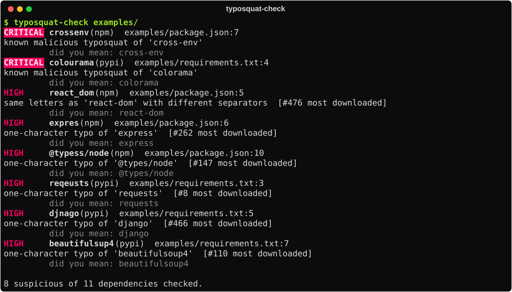

<p align="center">
  
</p>

**Catch typosquatted, look-alike and AI-hallucinated package names before you
`pip install` or `npm install` them.**

[](https://github.com/tahaSec/typosquat-check/actions/workflows/ci.yml)


One wrong letter is all it takes. `colourama`, `python3-dateutil`,
`jeIlyfish` (capital *i*) and `crossenv` were all real malicious packages
that stole credentials from developers who mistyped a name. Today there is a
new variant: **slopsquatting**. AI assistants invent package names that
don't exist, and attackers register those names.

`typosquat-check` reads your `requirements.txt`, `pyproject.toml` and
`package.json` and compares every dependency against the ~15,000 most
downloaded PyPI and npm packages.

<p align="center">
  
</p>

## What it detects

| Technique | Example | Severity |
|-----------|---------|----------|
| Known malicious packages | `colourama`, `crossenv` | critical |
| One-character typos (insert, delete, swap, replace) | `reqeusts`, `djnago`, `urlib3` | high |
| Look-alike characters | `nurnpy` (rn → m), `1odash` (1 → l) | high |
| Separator confusion (npm) | `react_dom` vs `react-dom` | high |
| Scope squatting | `@typess/node` | high |
| Brand impersonation with affixes | `requests-python`, `py-numpy` | medium |
| **Package does not exist** (`--online`) | names hallucinated by an AI | high |
| **Brand-new package** (`--online`, < 30 days) | freshly registered names | medium |

Severity depends on how popular the impersonated package is. Attackers target
the most downloaded names, so near-matches of niche packages are only
reported as `low`. Tested on Home Assistant's 1,300+ dependencies, it gives
**zero** high or medium false positives.

## Install

```bash
pip install git+https://github.com/tahaSec/typosquat-check
```

## Usage

```bash
typosquat-check                          # scan the current project
typosquat-check requirements.txt package.json
typosquat-check --pypi reqeusts numpyy   # check names before installing
typosquat-check --npm expres
typosquat-check --online                 # also ask PyPI / npm (finds hallucinated names)
typosquat-check -f json
typosquat-check --fail-on medium
```

Supported files: `requirements*.txt` / `*.in` (follows `-r` includes),
`pyproject.toml` (PEP 621, Poetry, dependency groups) and `package.json`
(all dependency types, `npm:` aliases).

### Check what your AI assistant suggested

```bash
typosquat-check --online --pypi fastapi-auth-jwt-helper-pro
HIGH     fastapi-auth-jwt-helper-pro (pypi)
         does not exist on the registry. Anyone can register this name
         (slopsquatting / dependency confusion). Was it suggested by an AI?
```

### In CI

```yaml
- run: pip install git+https://github.com/tahaSec/typosquat-check
- run: typosquat-check --online
```

### As a library

```python
from typosquat_check import check_name

finding = check_name("reqeusts", "pypi")
print(finding.severity, finding.similar_to)   # high requests
```

## Updating the popular-package lists

The lists live in `src/typosquat_check/data/` and come from
[hugovk/top-pypi-packages](https://github.com/hugovk/top-pypi-packages) and
[wooorm/npm-high-impact](https://github.com/wooorm/npm-high-impact). Refresh
them with:

```bash
python scripts/update_lists.py
```

## Contributing

Found a real typosquat that isn't caught, or a false positive? Please open an
issue. Additions to the known-malicious list need a public reference.

```bash
pip install -e ".[dev]" && pytest
```

---

## Türkçe

`typosquat-check`, projendeki bağımlılıklar arasında **sahte paket** olup
olmadığını kontrol eder. `requests` yerine `reqeusts` yazmak gibi tek harflik
hatalar, benzer görünen karakterler, bilinen zararlı paketler ve yapay
zekânın uydurduğu, aslında var olmayan paket adları (slopsquatting) bunlara
dahildir. `requirements.txt`, `pyproject.toml` ve `package.json` dosyalarını
okur.

```bash
pip install git+https://github.com/tahaSec/typosquat-check
typosquat-check --online
```

## License

MIT © Muhammed Taha Özer. The bundled package-name lists come from the
projects linked above.
